# Aeris

Aeris connects residents and NTMWD staff in Melissa, Texas, through odor reports, community mapping, and investigation updates.

<p>
  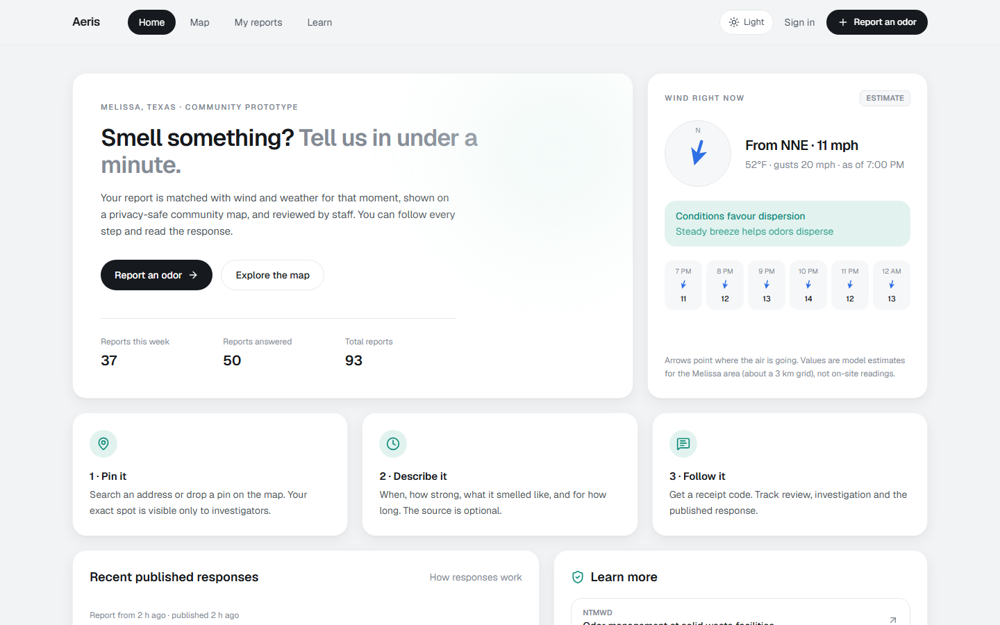
  &nbsp;
  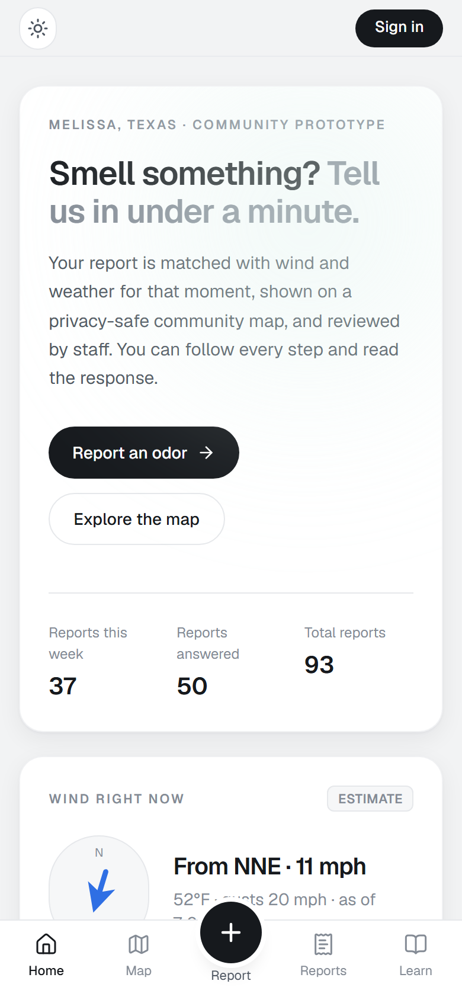
</p>

[](https://render.com/deploy?repo=https://github.com/yasyanya/aeris)

## How it works

**Odor reporting:** residents choose a location by address search or a map pin, then describe the odor, time, intensity, and duration. Duration is optional. The app creates an editable summary and a receipt code for tracking.

<p>
  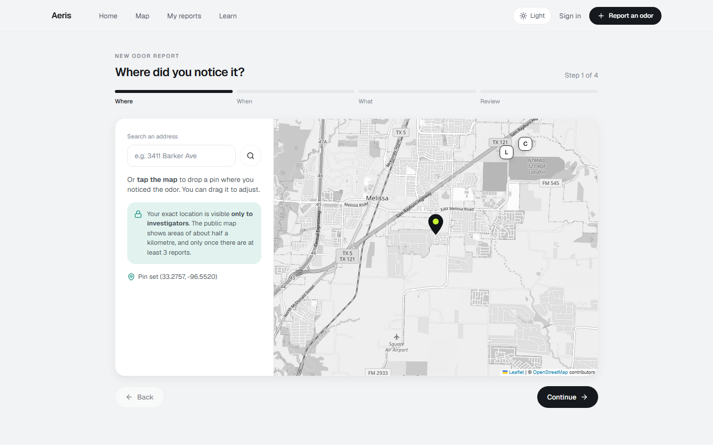
  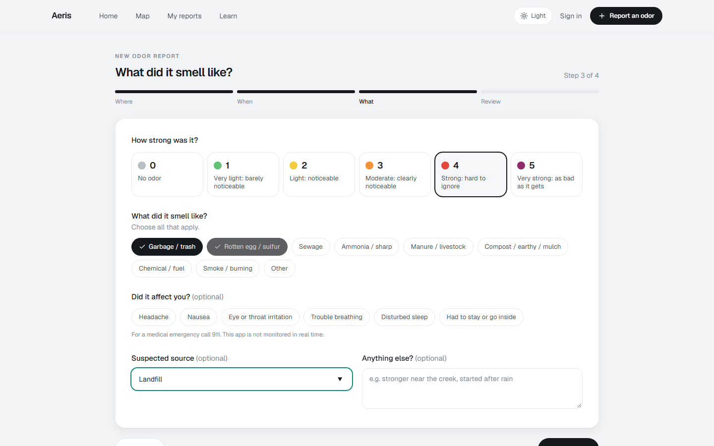
  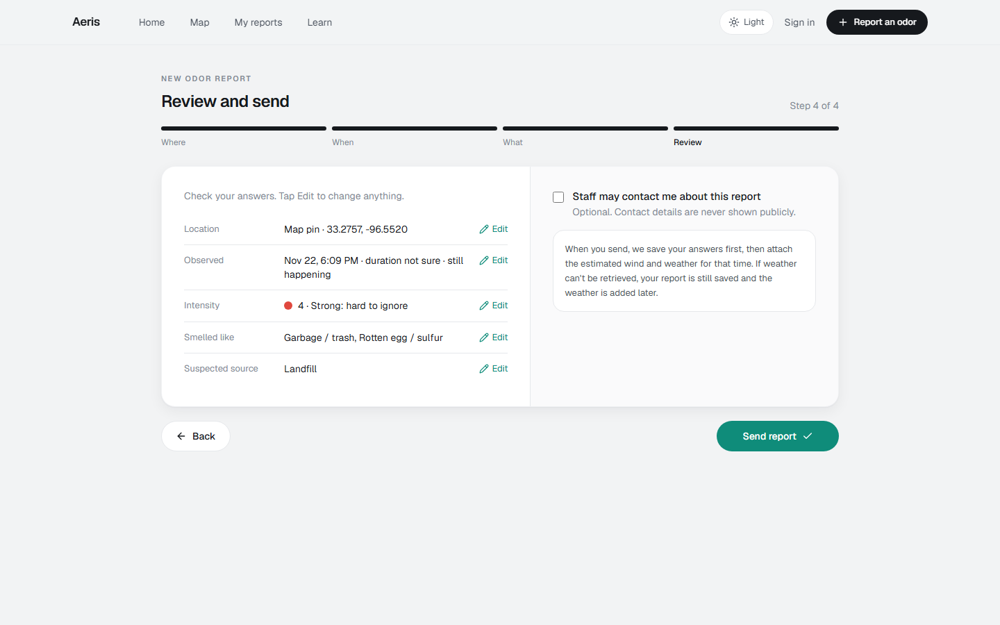
</p>
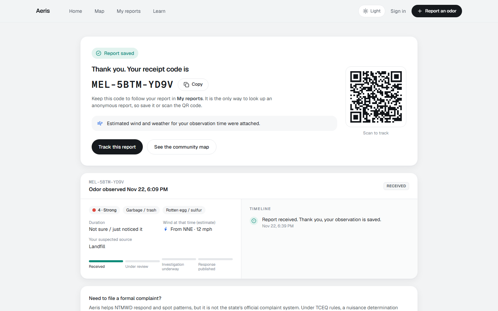

**Community map:** Leaflet and OpenStreetMap show nearby facilities, wind information, and reports grouped into hexagons about 500 metres across. Colours show the median reported intensity. Date filters (24 hours, 7 days, 30 days) help users explore patterns.

<p>
  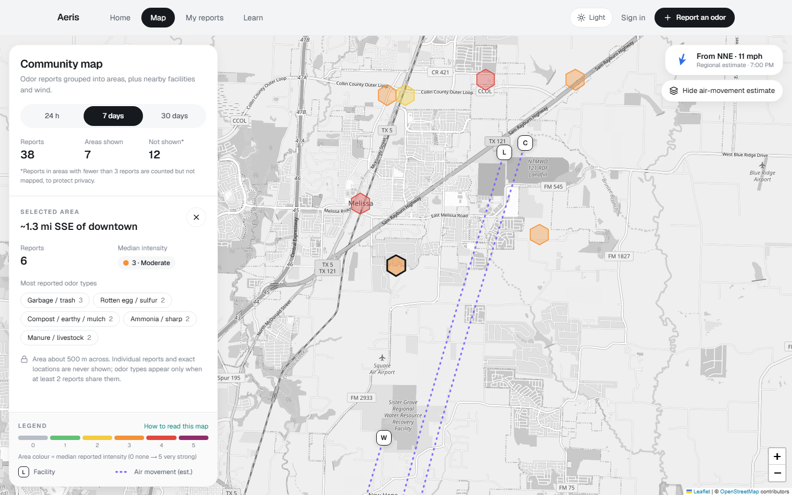
  &nbsp;
  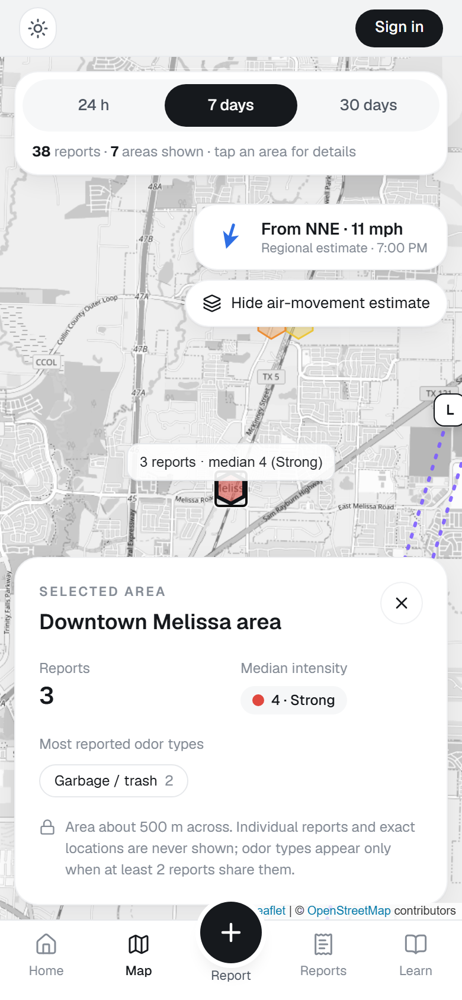
</p>

**Weather matching:** Open-Meteo provides modelled weather for the observation time. If it is unavailable, the app falls back to National Weather Service observations from McKinney airport. Wind is interpolated as vectors so changes across north are handled correctly. Reports stay saved if weather retrieval fails.

**Possible-source screening:** the app compares the wind direction with each facility's direction and distance, then traces the air backward over three hours in 10-minute steps. It flags facilities within the upwind sector or near the estimated path. Missing weather, calm wind, or shifting winds make the result inconclusive. These estimates guide investigations; they do not confirm a source.

**Event detection:** three or more reports rated 3 or higher within an hour and 2 km of each other trigger a possible-event notice for staff to review.

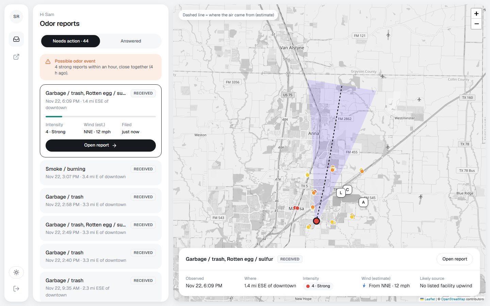

**Investigation updates:** staff record observations and draft responses. Managers approve responses before they are published. Residents follow progress with their receipt code or account.

<p>
  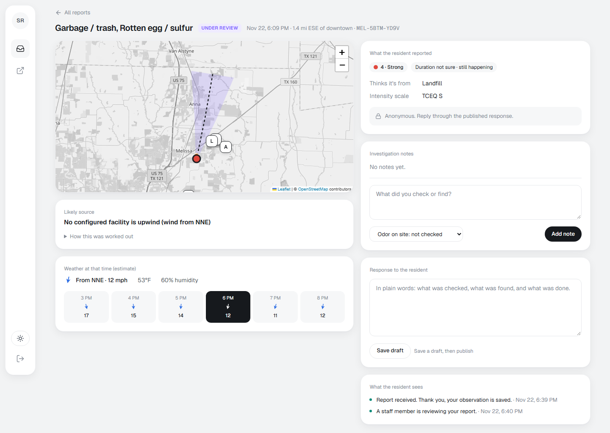
  &nbsp;
  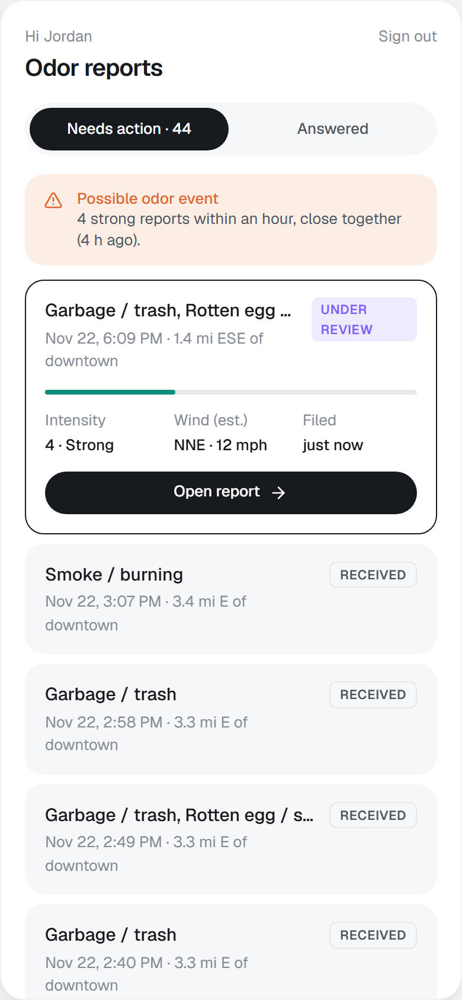
</p>
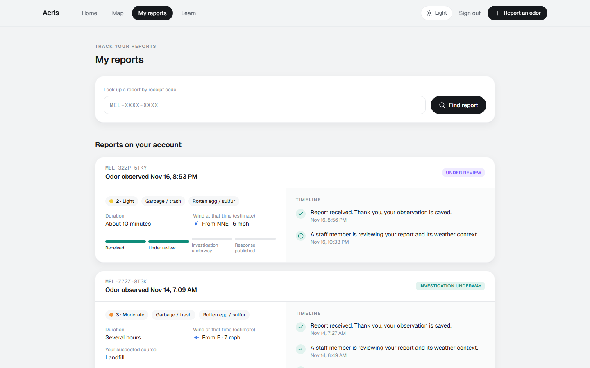

**Public-map privacy:** only areas with at least three reports are displayed, and an odor category needs at least two matching reports. Exact report locations, notes, and contact details never reach the public map. These thresholds count reports, not unique people.

**Education:** short explanations and links to NTMWD and TCEQ resources help residents understand odors, weather, and the reporting process.

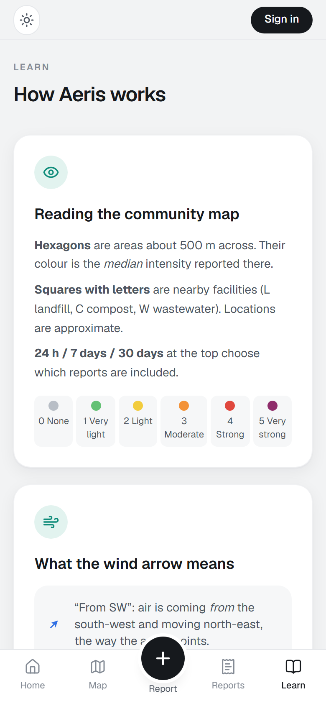

## Run it locally

Requires Node.js 22.13 or newer.

```bash
npm install
npm run seed   # optional: demo data with real recent weather
npm run dev    # http://localhost:3000
npm test
```

Demo accounts: `resident@demo.aeris`, `staff@demo.aeris`, `manager@demo.aeris`. The password for all three is `solvefortomorrow`. Residents can also report without an account.

On Render's free plan the app sleeps after about 15 minutes without visitors, and demo data is reloaded on each start.

## Built with

Next.js, TypeScript, Tailwind CSS, SQLite, Leaflet, OpenStreetMap, Open-Meteo, and the National Weather Service API. Sign-in uses iron-session and bcrypt. Source screening uses explainable rules rather than machine learning.

Facility locations are approximate. This is a prototype, not an official complaint channel. Formal complaints go to [TCEQ](https://www.tceq.texas.gov/compliance/complaints).
